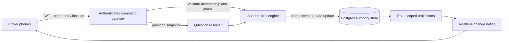

# Online Player Game Design

**Status:** Proposed for user review  
**Date:** 2026-10-24  
**Product:** Jet Lag Hide + Seek mobile game

## Goal

Make the app a reliable online replacement for the standard physical Hide + Seek game. Each participant uses their own phone. The app assigns a role-specific game view, handles the scanned base rules and Investigation Book, computes location-based answers, draws the printed card rewards, and updates the seekers' map from each resolved answer.

The existing single-device referee mode remains useful for demos, testing, and fallback play. It is not the primary multiplayer implementation.

The implementation should preserve the existing rules engine, role-scoped projection model, map geometry, scenario-sharing workflow, and game-first visual direction where they fit. The reference map is a behavior/workflow reference rather than a pixel-level UI target.

## Current evidence and constraints

- The suite passes 230 tests with the project's `.venv` on `PATH`; mobile TypeScript typecheck passes. A real-runtime test completes a full single-device round.
- The app already has Supabase Auth, tables, snapshot/event persistence, polling fanout, role projections, attachment storage, and an `OnlineAuthorityRuntime` TypeScript class.
- `OnlineAuthorityRuntime` is currently instantiated by the mobile app. The Supabase REST data client uses the anon key and the development migration grants broad table access. This is a prototype, not a trusted shared authority.
- Seeker location sharing and map tracks exist for seeker-side views. Hider devices cannot currently publish location, and hider views do not receive seeker tracks.
- The hider's exact location is intentionally omitted from seeker projections. Preserve this invariant.
- The pack contains 80 question templates reconciled to the scanned Investigation Book and 37 card definitions (125 card instances); 21 importer warnings remain and many card effects are not authoritative. The generated pack is draft and should be reconciled against the local scanned books before claiming physical-game parity.
- Existing map tools support region composition, station discovery, saved local scenarios, compressed link sharing, and question overlays. A complete searchable administrative-boundary workflow, content-pack selector, physical-device GPS test, and reliable multi-device field test remain open.

## Product behavior

### Match creation and participants

- A host creates an online match and shares a short join code or QR link.
- Each participant joins from their own authenticated app installation. A display name is separate from account identity.
- The host can see the roster, assign or reassign roles before start, remove a participant before start, and close the lobby. Participants can leave before the match starts and reconnect to an active match after temporary disconnection.
- Once play starts, roles, hider rotation, ruleset, map region, and content-pack version are authority-controlled and appear consistently on all participant phones.
- Reconnection restores only the caller's current role-appropriate projection and pending action state.

### Role-specific location visibility

- **Hiders:** see the playable map, all current seeker locations, active question, their team's answers, and their private/shared hider hand. Hider exact coordinates remain private to the authority and hider-side projection.
- **Seekers:** see the playable map, their own seeker team's locations, public match information, question history, and question-derived search-area overlays. They never receive the hider's exact or raw coordinates.
- Each device publishes timestamped coordinates, accuracy, and permission/availability state while the player is in an active movement phase. Sampling cadence is configurable by the selected ruleset and tuned for battery use. Background location support is required for normal pocketed-phone play; platform permission loss and operating-system throttling must be visible in the UI.
- Stale or low-accuracy samples are labeled and excluded from automatic answers. The UI must ask for a fresh fix or show that a question cannot yet be resolved; it must not guess.
- The server remains the source of truth for location timestamps and answer inputs. Client-submitted actor IDs, roles, teams, and answer results are not trusted.

### Questions, automatic answers, and map effects

- Seekers can choose any Investigation Book question available at the selected scale. Repeated-question rules and costs follow the scanned book.
- When a question is accepted, the authority records the question event and freezes the valid location samples used for its answer. The proposed default is the latest fresh fix from the hider and the relevant seeker/team at acceptance time.
- A versioned question resolver interprets the question template and frozen inputs. Supported automatic questions return an explicit answer with its measurement basis and confidence/precision. Questions that depend on evidence or subjective real-world judgement use a named assisted flow with required evidence/confirmation rather than pretending to be automatic.
- The authority records the answer, provenance, location sample IDs, resolver version, and generated constraint artifact. The hider device shows the answer and any response action. The seekers receive the answer and applicable geometry through their scoped projection.
- Search geometry is clipped to the selected playable area. Approximate, exact, and manual-review results are identified in both the map and clue history. Contradictory or unsupported answers are surfaced and never silently erase the candidate area.
- After an answer, the app applies the Investigation Book's draw/pick reward. The hider draws and chooses cards in-app; the engine enforces hand limits and records drawn, held, played, resolved, and discarded cards. Every standard base-game card has an explicit supported automatic or assisted resolution. No physical card should be required to complete the standard game.

### Map region setup

- Match setup offers a search box for country administrative areas, such as a country, region, or municipality. Selecting a result creates a bounded playable region from its administrative geometry.
- The host can combine and subtract areas, inspect the boundary, find stations, and confirm the final region before match start. The server stores the chosen geometry and source/version metadata in the match.
- The workflow follows the reference map's boundary search and editable region composition while using the app's existing game map. It must support a shareable/portable region scenario and handle missing or invalid boundary data clearly.
- Geometry from third-party sources carries attribution and version/source metadata. Region search is bounded and cached; requests remain on demand and avoid bulk downloading map tiles.

### Content and future game variants

- A match selects one immutable, versioned content pack. A pack includes ruleset(s), scale policies, investigation questions, card definitions/effects, supported resolvers, map presets, and provenance.
- The first selectable pack is the standard base game reconciled to the scanned rulebook and Investigation Book. Experimental variants and expansions are separate packs or rulesets, never silently merged into the base game.
- The first delivery needs a content-pack chooser and validation/reporting for imported packs. Authoring and editing packs is a later tool, but the runtime must not hard-code Jet Lag question or card behavior into screen components.
- Future game mechanics extend through typed, registered resolver/effect kinds and versioned pack data. Packs cannot execute arbitrary downloaded code.
- Scanned books and workbook-derived content remain personal/private-use material unless redistribution rights are reviewed. Do not add full scans or book-length transcription to a public release.

## Architecture

### Trusted online authority

- Reuse Supabase Auth, Postgres, Realtime, and Storage, but move command execution out of every mobile process.
- A user-authenticated Supabase Edge Function is the command gateway. It binds the authenticated user to a server-side match membership, validates role/phase/permissions, loads the authoritative state, runs the shared TypeScript engine, and writes accepted events/state using an optimistic revision check or an equivalent atomic transaction.
- Client-readable tables contain only authorized projections. Raw hider coordinates, private card hands, internal audit data, and authority events stay in protected storage. RLS denies direct client writes to authoritative state.
- Realtime or polling delivers change notices; clients fetch a scoped projection. Private payloads are never broadcast to a general match channel.
- Commands carry idempotency keys and expected revisions. Reconnect obtains a fresh scoped snapshot and then catches up. Rejected, duplicate, stale, or unauthorized commands have explicit outcomes.
- Server-side dice/randomness, role assignment, card draw order, answer calculation, and map constraint derivation are authority-controlled. The mobile client only requests actions and renders server results.
- Keep the existing in-process runtimes for tests, referee mode, and development. Do not expose service keys in the app bundle.

Supabase currently documents user-JWT authentication for Edge Functions and a 2-second CPU-time limit per request. The implementation must benchmark engine and geometry workloads against the deployed runtime. If authoritative map calculation exceeds that limit, move the heavy spatial calculation to PostGIS or a dedicated server-side worker without moving trust back to clients. Sources: [Supabase Edge Function authentication](https://supabase.com/docs/guides/functions/auth) and [Edge Function limits](https://supabase.com/docs/guides/functions/limits), checked 2026-10-24.

### Shared engine and data flow

The existing transport interfaces and command/event model remain the client boundary. The implementation should add server deployment and atomic storage semantics behind that boundary instead of creating a second rules engine.

## Failure and privacy behavior

- If a player disconnects, the match continues according to rules, while that player's location freshness is explicit. Commands made offline remain pending drafts and are never replayed as accepted without server confirmation.
- If the hider fix is stale, a location question pauses in a refresh-needed state or follows an explicit ruleset fallback. The hider's device shows the request. No stale coordinate is silently substituted.
- If a player denies location permission, the app explains the consequence and offers the ruleset's approved manual/referee fallback only where allowed.
- If map data is unavailable or incomplete, the region is not silently replaced. The host can choose another supported region or use an explicitly marked manual boundary workflow.
- Every role projection is tested against hidden-location and private-card leakage, including event payloads, snapshots, logs, storage paths, and Realtime notices.
- Player removal revokes future match access and attachment access. Existing realtime channels may retain cached authorization temporarily, so revocation must force reconnect or expire active tokens before treated as complete.

## Delivery sequence

1. **Online authority and identity:** move command validation to the server; make match membership, host/player roles, revision checks, scoped projections, and RLS authoritative; support separate-device join/reconnect/remove flows.
2. **Role-aware location:** implement seeker-to-hider visibility, hidden hider coordinate ingestion, freshness/accuracy policy, foreground/background tracking, and secure projection tests.
3. **Automatic question cycle:** reconcile question data to scans, resolve supported questions from frozen location inputs, draw the exact card reward, and publish the resulting map geometry to seekers.
4. **Standard-game card parity:** reconcile all standard base-game cards to the scans, implement typed automatic/assisted effects, and remove dependence on physical cards for normal play.
5. **Region and content setup:** searchable administrative boundaries and region composition, selected immutable content pack, import validation, and shareable map scenarios.
6. **Field validation:** play a complete round across at least one hider phone and two seeker phones on cellular data, including backgrounding, stale GPS, reconnect, question resolution, card rewards, endgame, found, score, and next-round rotation. Also retain the full single-device referee round as a regression path.

## Acceptance criteria

- Two or more separately authenticated phones can join the same online match, reconnect, and receive their own role-scoped state.
- A hider sees all seeker locations; seekers see their team locations and clue-derived area but no hider exact coordinates in any client-visible payload.
- The server rejects client attempts to impersonate a role, fake a question answer, draw outside the active reward, or modify authoritative region/state directly.
- For each supported automatic question, the answer is reproducible from the recorded valid location snapshots and resolver version; the resulting seeker map geometry matches the answer and stays inside the playable region.
- Stale/missing location, permission denial, unsupported questions, and low-confidence geography have visible, rule-compliant flows.
- The standard base game can complete a full round and draw/resolve its card rewards with no physical cards or referee device required.
- Hosts can search and select an administrative boundary, compose the play region, select a content pack, and share a map scenario.
- Existing single-device integration coverage remains passing; server integration coverage includes concurrent commands, reconnect/idempotency, authz, and privacy-leak assertions.
- The physical multi-phone field test passes before calling the online game a reliable physical-game substitute.

## Explicitly out of scope for the first online release

- LAN/nearby multiplayer without internet.
- User-generated arbitrary executable plugins, a public content marketplace, or ranked/anti-cheat certification.
- Silent automation of subjective physical-world truth, photo quality, public access, or path proximity. These remain explicit evidence/confirmation actions in the app.
- Pixel-identical recreation of the reference Leaflet workbench or offline map-tile downloads.
- Expansion rules mixed into the standard base-game pack.

## Review notes

- Default location answer policy: freeze the latest fresh, sufficiently accurate hider and relevant seeker/team fixes at question acceptance. If a fix is stale, request a refresh rather than calculate from stale data.
- Default visibility policy: hiders see seeker locations; seekers never see the hider's exact location; seekers see their own team's positions.
- Recommended hosting: authenticated Supabase Edge Function as gateway plus Postgres as durable authority, with PostGIS/dedicated worker available if geometry exceeds Edge Function limits.
- The initial codebase audit verified the existing single-device round and 199 tests, plus mobile typecheck. The current worktree passes 230/230 tests. Neither check verifies native GPS or multi-device field play.
